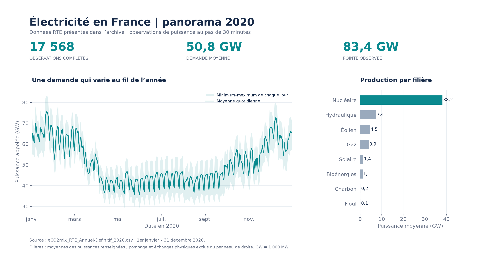
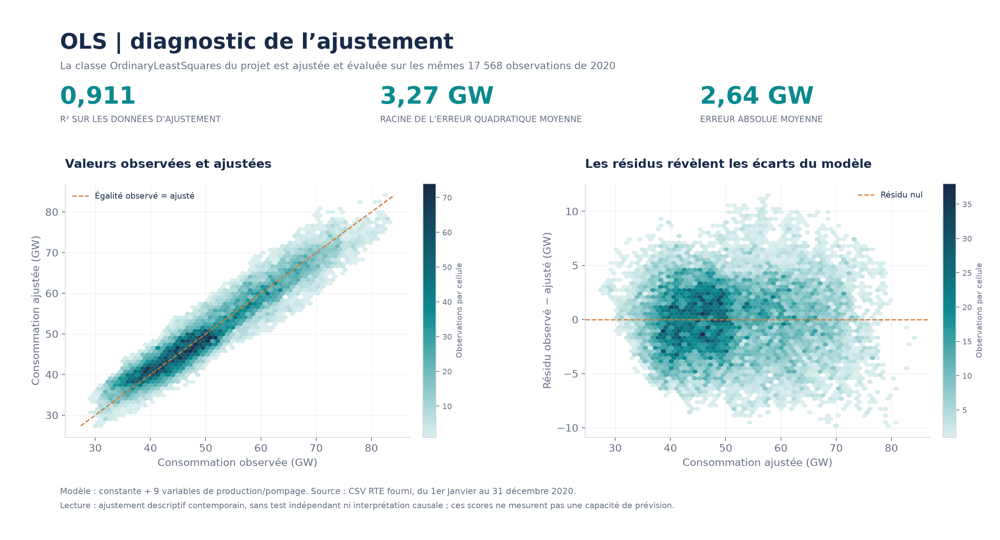

# linearmodel

**Des données électriques aux diagnostics d'une régression linéaire multiple.**

`linearmodel` est un projet Python pédagogique qui relie préparation de données, exploration statistique et moindres carrés ordinaires (OLS). Son cœur est une implémentation NumPy de la régression, avec constante optionnelle, prédiction, calcul du R² et visualisation des résidus.

L'exemple fourni étudie les valeurs de consommation et de production du fichier `eCO2mix_RTE_Annuel-Definitif_2020.csv`. Les graphiques ci-dessous sont calculés à partir de ce fichier et du modèle du projet.



*La bande représente le minimum et le maximum observés chaque jour ; la courbe représente la moyenne quotidienne. Les puissances sont converties de MW en GW.*

## Ce que le projet permet d'explorer

- **Préparer un jeu de données** avec Pandas et sélectionner les observations numériques complètes.
- **Ajuster une régression multiple** avec `OrdinaryLeastSquares`, examiner les coefficients et produire des valeurs ajustées.
- **Étudier les écarts** avec le R², les résidus et des graphiques d'exploration.
- **Explorer les relations entre variables** grâce à la matrice de corrélations et aux fonctions de visualisation du package.

Les exemples portent sur des variables observées au même instant. Ils illustrent un ajustement descriptif ; ils ne constituent pas un modèle de prévision de la demande électrique.

## Installation locale

Décompresser l'archive, puis ouvrir un terminal à la racine du projet, dans le dossier contenant `setup.py`.

```bash
python -m venv .venv
```

Activer l'environnement :

```powershell
# Windows PowerShell
.venv\Scripts\Activate.ps1
```

```bash
# macOS / Linux
source .venv/bin/activate
```

Installer le projet et ses dépendances :

```bash
python -m pip install .
```

Les dépendances déclarées sont NumPy, Pandas, SciPy, Matplotlib, Seaborn et Colorama. Leur version n'est pas verrouillée dans l'archive ; l'environnement utilisé pour les graphiques est consigné dans [`docs/figure_metrics.json`](docs/figure_metrics.json).

## Exemple avec les données de l'archive

Ce code utilise la classe réellement présente dans le package. Il se lance depuis la racine du projet.

```python
import pandas as pd
from linearmodel.ordinary_least_squares import OrdinaryLeastSquares

features = [
    "Fioul", "Charbon", "Gaz", "Nucléaire", "Eolien",
    "Solaire", "Hydraulique", "Pompage", "Bioénergies",
]

data = pd.read_csv("eCO2mix_RTE_Annuel-Definitif_2020.csv", sep=";")
data = data.dropna(subset=["Consommation", *features])
X = data[features].to_numpy(dtype=float)
y = data["Consommation"].to_numpy(dtype=float)

model = OrdinaryLeastSquares(intercept=True)
model.fit(X, y)  # Modifie le modèle ; ne renvoie pas self.
y_fitted = model.predict(X)

print("Observations :", len(y))
print("Coefficients :", model.get_coefficients())
print("R² d'ajustement :", model.determination_coefficient(X, y))
```

Avec `intercept=True`, le premier coefficient est la constante, puis viennent les coefficients dans l'ordre des colonnes de `X`. Fournir une matrice numérique bidimensionnelle et utiliser le même ordre de variables lors de la prédiction.

Pour afficher un diagnostic interactif :

```python
model.plot_residuals(X, y)
```

## Lire les résultats avec le bon périmètre

La classe minimise la somme des carrés des résidus à l'aide des équations normales :

$$
\hat{\beta} = (X^{\mathsf T}X)^{-1}X^{\mathsf T}y,
\qquad \hat{y} = X\hat{\beta},
\qquad e = y - \hat{y}.
$$

Lorsque `intercept=True`, une colonne de 1 est ajoutée à la matrice des variables explicatives.



**Le modèle est ajusté et évalué sur les mêmes observations.** Le R², la racine de l'erreur quadratique moyenne (RMSE) et l'erreur absolue moyenne (MAE) décrivent cet ajustement. Ils ne mesurent pas la qualité sur de nouvelles observations. Les neuf variables comprennent le pompage ; les échanges physiques ne sont pas inclus dans `X`.

Chaque cellule colorée regroupe des observations proches ; sa couleur indique leur nombre. La ligne orange du premier panneau représente l'égalité entre valeur observée et valeur ajustée. Dans le second panneau, un résidu positif signifie que la consommation observée dépasse la valeur ajustée.

La consommation et les filières électriques sont liées par le fonctionnement du système énergétique. Une bonne association statistique entre ces grandeurs contemporaines ne prouve ni un effet causal ni une capacité de prévision.

## Données et préparation

Le CSV présent dans l'archive contient **35 136 horodatages** du 1er janvier au 31 décembre 2020. Les lignes sont espacées de quinze minutes, mais la consommation et les filières ne sont renseignées qu'aux demi-heures : **17 568 observations complètes** sont utilisées dans les deux figures.

Les lignes intermédiaires contiennent les prévisions J et J-1. Elles ne sont pas interprétées comme des mesures de consommation manquantes de façon aléatoire, et aucune interpolation n'est appliquée pour les graphiques.

- Séparateur du fichier : `;`.
- Puissances de consommation et de production : MW, affichées en GW dans les figures.
- Colonnes de date conservées dans le générateur pour les agrégations quotidiennes.
- Le panneau des filières présente les moyennes des puissances renseignées ; le pompage et les échanges physiques en sont exclus.
- Aucun total annuel d'énergie n'est calculé dans cette documentation.

Le nom du fichier identifie un export RTE/eCO2mix. L'archive ne fournit pas de lien précis de téléchargement, de notice de provenance ni de licence du jeu de données ; ces métadonnées restent à compléter avant redistribution séparée du CSV.

## Reproduire les figures

```bash
python docs/generate_figures.py
```

Le script utilise le CSV fourni et importe `OrdinaryLeastSquares` depuis le package. Il exporte chaque figure en **PNG haute résolution** et en **SVG vectoriel**, sans saisie manuelle des indicateurs.

- [`docs/assets/rte_panorama_2020.svg`](docs/assets/rte_panorama_2020.svg) : version vectorielle du panorama.
- [`docs/assets/ols_diagnostic_2020.svg`](docs/assets/ols_diagnostic_2020.svg) : version vectorielle des diagnostics.
- [`docs/figure_metrics.json`](docs/figure_metrics.json) : effectifs, métriques, coefficients, versions et empreinte SHA-256 du CSV.

## Organisation du projet

```text
linearmodel/
  ordinary_least_squares.py   # Ajustement, prédiction et diagnostics OLS
  statistics.py              # Statistiques descriptives et corrélations
  visualization.py           # Graphiques Matplotlib et Seaborn
  print_with_style.py        # Affichage console avec Colorama
main.py                      # Exemple d'analyse initial
eCO2mix_RTE_Annuel-Definitif_2020.csv
docs/
  generate_figures.py         # Reproduction des figures de ce README
  figure_metrics.json         # Résultats et traçabilité
  assets/                    # Figures PNG et SVG
```

## Points techniques à connaître

Le code métier d'origine est conservé. Cette documentation distingue les fonctions disponibles des améliorations encore nécessaires :

- **Résolution OLS.** `fit` calcule explicitement l'inverse de `X.T @ X`. Des colonnes dépendantes ou une matrice mal conditionnée peuvent rendre l'ajustement impossible ou instable. Les valeurs manquantes et l'ordre des colonnes sont à gérer avant l'appel.
- **Intervalles de confiance.** La méthode `confidence_intervals` existe, mais son calcul ne repose pas sur la matrice complète de covariance des coefficients. Ne pas utiliser ses bornes comme intervalles OLS validés pour une régression multiple.
- **Q-Q plot.** `plot_qq_plot` compare les résidus à un échantillon normal aléatoire plutôt qu'à des quantiles théoriques déterministes. Les figures de ce README n'utilisent pas cette méthode.
- **Statistiques descriptives.** `descriptive_statistics` appelle `.apply` sur le résultat de `np.std`. Dans l'environnement vérifié, cet appel lève une `AttributeError` avec un tableau NumPy comme avec un DataFrame. Cette fonction nécessite une adaptation ; `data.describe()` peut servir à l'exploration du DataFrame en attendant.
- **Exemple initial.** `python main.py` désigne le fichier d'exemple à la racine contenant le CSV. Il appelle la fonction de statistiques descriptives ci-dessus et rencontre donc cette incompatibilité dans l'environnement vérifié. Les commandes console déclarées dans `setup.py` ciblent `linearmodel.main`, un module absent de l'archive : utiliser l'exemple API et le générateur de figures présentés ici.

## Auteur et licence

Projet d'**Ahmed ABBADI**. Le fichier `setup.py` déclare la licence MIT pour le code, mais aucun fichier `LICENSE` n'est présent dans l'archive d'origine. Ajouter le texte de licence correspondant avant publication ; la licence des données doit être documentée séparément.
